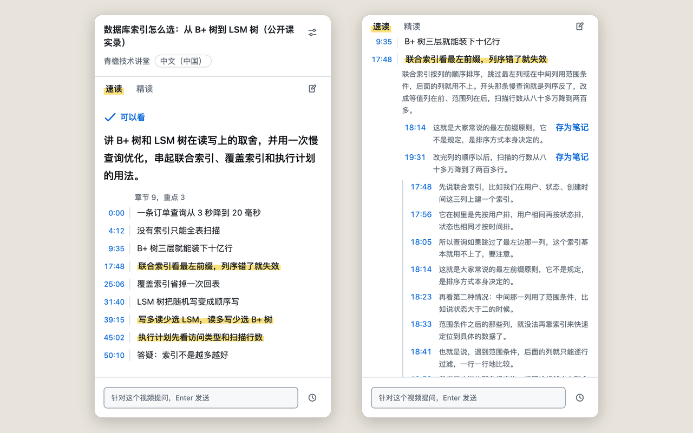
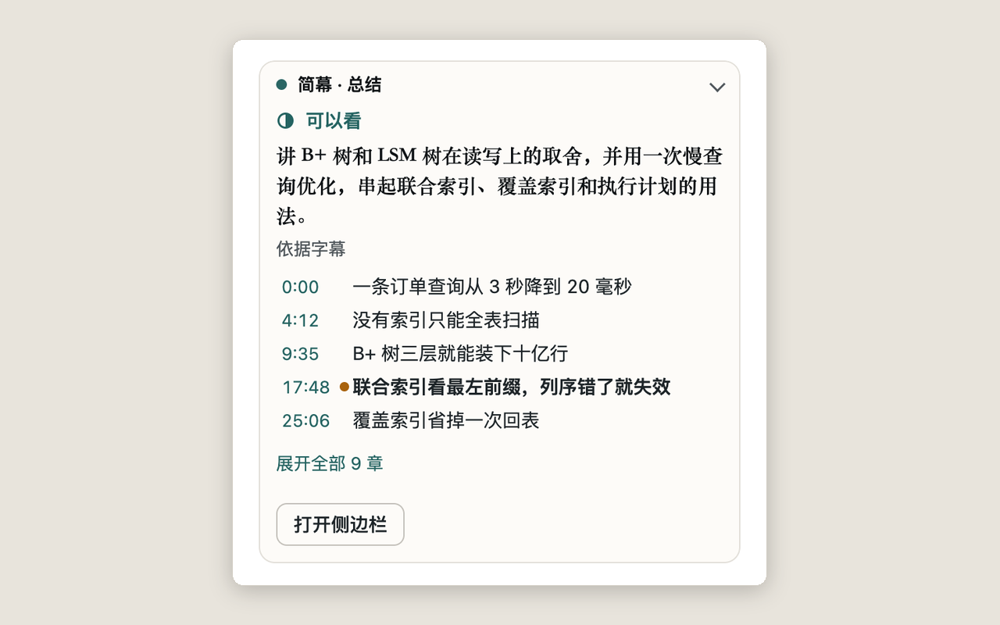

# Jianmu (简幕): Watch or Skip, Then Study

[中文](README.md)

Jianmu helps you work out within a few minutes whether a long Bilibili or YouTube video is worth watching and which parts matter. Once you decide to watch, it helps you read along closely.

> **Status: not released yet, and there is no package to download.** On Bilibili, the main flow (reading subtitles, generating overviews, Q&A with citations, taking notes, the card on the video page and the settings page), Watch Later triage, Generate all in this window, Verdict on open and the features listed below are on the main branch, and automated tests run them against locally simulated pages. The developer now uses it day to day on Bilibili. On YouTube, turning it on per site, reading subtitles and opening the transcript for you are on the main branch too. The developer uses them day to day on YouTube as well, and they will be in the first version. The first version goes out on GitHub once both sites work end to end ([PRD](notes/product-prd.md), section 1, in Chinese).



Jianmu is a Chrome extension (Manifest V3). There is no developer backend and no account. You need your own API key. Notes and overviews are kept on your computer, and subtitles and similar content only go to the model service you choose. The interface and what the model writes can be in Simplified Chinese, Traditional Chinese or English.

## Planned features

This describes where the project is heading. Only part of it is built so far, and the [PRD](notes/product-prd.md) (in Chinese) is what defines the scope. The first version will support both Bilibili and YouTube.

- **Verdict on open**: once you switch it on, any video on Bilibili, or on YouTube once it's turned on, longer than a set length (10 minutes by default) gets an overview and a one-line verdict as soon as you open it, shown right on the card on the video page with no clicking. Tabs opened in the background are queued too, with the one you are watching going first, so the more tabs you open, the more of your API quota it uses. The switch is off on a new install, and you have to agree to the data notice before turning it on. While it is on, the video's subtitles, title and length, creator or channel name, and description are sent automatically to the model service you chose. Foreign-language videos are not translated automatically.
- **Skim**: a one-line verdict with a recommendation (Worth watching, Watch the key parts, Skip, Not enough info), plus timestamped chapters. Expand a chapter to read its subtitles.
- **Study**: subtitles follow playback, and you can ask questions, get selected text explained and take timestamped notes at any time. Long videos switch here automatically after a minute of continuous playback.
- **Explain this frame**: click the icon on the player and Jianmu sends that frame, with a few subtitle lines either side, to a model that can read images, so it can explain the slide, formula, code or chart on screen. The screenshot is used once and never stored.
- **Q&A**: answers come with timestamps and the subtitle lines they quote. Click one to jump back to the video and check. Citations are verified, and when the evidence is thin the answer says so.
- **Translation**: subtitles are translated with your own model and shown beside the original. With the language set to English, English subtitles are translated into Simplified Chinese and everything else into English. With it set to Simplified or Traditional Chinese, Chinese subtitles in either script go into English and everything else into the Chinese you chose. Once started, the whole video is translated in the background, even after you close the side panel, and keeps using your quota until it finishes or you stop it.
- **Tidy up subtitles**: speech-recognised subtitles have no punctuation. One click has your own model add punctuation and fix obvious sound-alike mistakes, and nothing else; any line it rewrites is shown as the original. Like translation, it runs to the end in the background once started.
- **Batch decisions**: Generate all in this window writes overviews for every Bilibili video open in the current window in one go, and Watch Later triage runs a quick first pass over your saved videos.
- **Your own model**: use as strong a model as you like, and set the reasoning effort for each feature separately. New installs start on the cheap settings.
- **Three languages**: the interface and what the model writes (overviews, verdicts, answers and explanations) can be in Simplified Chinese, Traditional Chinese or English. Choose under Language in the Appearance section of Settings. By default it matches the browser: Traditional Chinese if the browser uses Chinese as written in Taiwan, Hong Kong or Macao, Simplified Chinese for other Chinese, and English otherwise. Traditional Chinese follows Taiwanese usage. Anything already generated stays in the language it was written in.
- **Two sites, one tool**: Bilibili and YouTube share one side panel for verdicts, chapters and subtitles. Before release, the final package is checked on real pages. On YouTube you first click Turn on for YouTube in the side panel or in Settings, and Jianmu runs on YouTube pages only after you grant access. On a video, click Read subtitles in the side panel, and Jianmu opens the transcript on the page for you and reads it. If the page has no transcript, Jianmu reads the subtitles in the player instead, turning them on for you if needed and off again afterwards. Verdict on open and Generate all in this window work on YouTube too and read subtitles the same way. A transcript Jianmu opened for you is closed again afterwards.

On Bilibili, Jianmu reads subtitles and official summaries only for signed-in users (while signed out it reads just the video details such as title and length), never downloads audio or video, and leaves content confirmed as paid alone. The rules are in section 8.1 of the [PRD](notes/product-prd.md) (in Chinese). On YouTube, Jianmu sends no requests to the platform. It reads what the transcript already shows, plus the list of subtitle tracks the player already has (to mark the language and whether it was auto-generated). When the page has no transcript, it reads the subtitles the player has loaded itself. While reading, it leaves the player alone, except for turning subtitles on and off in that case. The rules are in section 8.2.

## Screenshots

The video, channel and subtitles in these screenshots were made up for the demo. The screenshots show the Chinese interface.





## Install and update

There is no package yet. The steps below are how it will work after the first release.

Requires Chrome 116 or later. Earlier versions can't install it.

The Chrome versions tested by hand on real pages will be listed before release. <!-- 待定：实机验证过的 Chrome 版本 -->

### Install

1. Go to this repository's [Releases](https://github.com/TIAN-TOM/jianmu/releases) page and download the latest `jianmu-<version>.zip`. The `.sha256` file with the same name lets you check the download is complete.
2. Unzip it into a folder that will stay put, for example one called `jianmu`, so that `manifest.json` sits directly inside it. You will use the same folder for updates, so don't delete or move it.
3. Open `chrome://extensions` in Chrome and turn on Developer mode in the top right corner.
4. Click Load unpacked and choose that folder.
5. Click the Jianmu icon in the toolbar to open the side panel, read the notice and click Turn on Jianmu. At first the icon sits in the puzzle-piece menu, and you can pin it to the toolbar from there. Right-click the icon to open Watch Later triage directly, or to switch the card on the video page and Verdict on open on or off.
6. Open Jianmu's settings page, pick a provider, enter your API key, tick the box to agree to the data notice and click Save and authorise. The AI features are then ready to use.

### Update

Jianmu doesn't check for new versions itself. To get notified, click Watch on this repository's page and tick Releases under Custom.

1. Download the new zip, unzip it and copy all of its files into your existing folder, replacing the old ones.
2. That's it. Jianmu notices that its files have changed and reloads itself, usually the next time you use it. If an overview, translation or similar job is running, or you're exporting, restoring a backup or clearing data, it waits for that to finish first. The side panel and Settings close when it reloads, and reopening them gives you the new version. To switch over straight away, open `chrome://extensions` and click the reload button on Jianmu's card.

Your notes, overviews, Q&A and settings are kept. Unless you ticked Remember the key on this computer, you will need to enter your API key again after updating. Don't remove the extension and load it again: removing it deletes the data Jianmu keeps on this computer.

## Privacy

There is no developer server. Notes, overviews, Q&A, settings and caches are all kept in the browser on your computer. Content such as subtitles, the title and description, your questions, and the frame you ask Jianmu to explain is only sent to the model service you chose after you agree to the data notice. Normally it is sent when you use an AI feature, and with Verdict on open switched on it is also sent automatically. See the [privacy policy](PRIVACY.md#english) for details.

## Key design choices

The design below is settled. The code is still being ported.

- **No backend.** The developer never receives users' content, so there are no accounts, no analytics and no server costs. The trade-off is that you bring your own key and pay for your own usage.
- **Site differences stay in the adapter layer.** Overviews, Q&A, tasks and storage are shared by both sites. Site-specific features are optional methods in the contract: when a site lacks one it simply isn't shown, and no data is faked.
- **Only one way to identify a video.** Every key is derived from `{platform, videoId, segment?}`. Subtitles and official summaries carry a content fingerprint, and every result records which version it was based on.
- **Enabling, permissions and consent are handled separately.** Reading on your computer needs your confirmation first, site access depends on browser permissions, and sending to a model needs separate consent. None of them stands in for another.
- **Anything that costs money has a known source and a limit.** A signal from a web page can't trigger a paid request on its own, and nothing is resent automatically after a cancel or a background interruption.
- **A lean toolchain.** TypeScript plus a hand-written esbuild build script. Unit tests run `.ts` files directly in Node, and the core logic doesn't depend on the browser.

For how the code is organised and why, see the [architecture design](notes/architecture.md) (in Chinese).

## Documents

- [PRD](notes/product-prd.md) (in Chinese): what is being built, for whom, the release plan and what counts as done at each step.
- [Architecture design](notes/architecture.md) (in Chinese): code structure, data, testing and build order.

## Development

Requires Node 24.12 or later and npm 11.10 or later.

```bash
npm ci
npm run check
```

Development conventions are in [AGENTS.md](AGENTS.md) (in Chinese). For how to report a security issue, see [SECURITY.md](SECURITY.md) (in Chinese).

## Licence and acknowledgements

Released under the MIT License, see [LICENSE](LICENSE).

YouTube is a trademark of Google LLC. 哔哩哔哩 and bilibili are trademarks of their respective owners. Jianmu is an independent tool made by one person. It is not affiliated with Google, YouTube or Bilibili, and is not authorised or endorsed by them.

Acknowledgements: Jianmu started from [Digest for Bilibili](https://github.com/biuworks/bilibili-digest), which in turn builds on [youtube-digest](https://github.com/zarazhangrui/youtube-digest).
