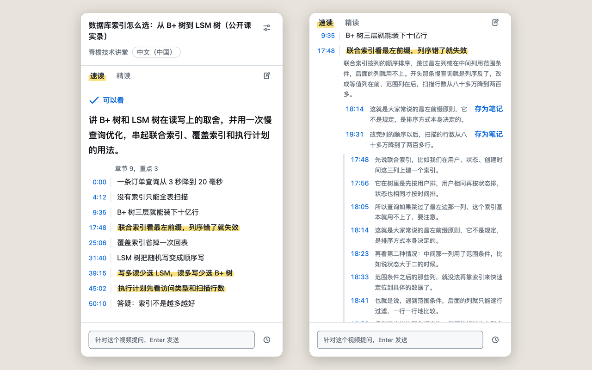
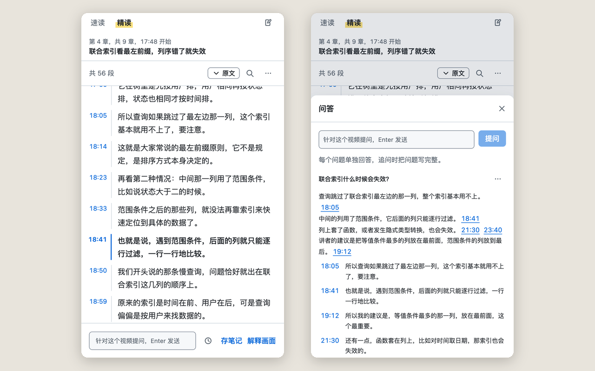
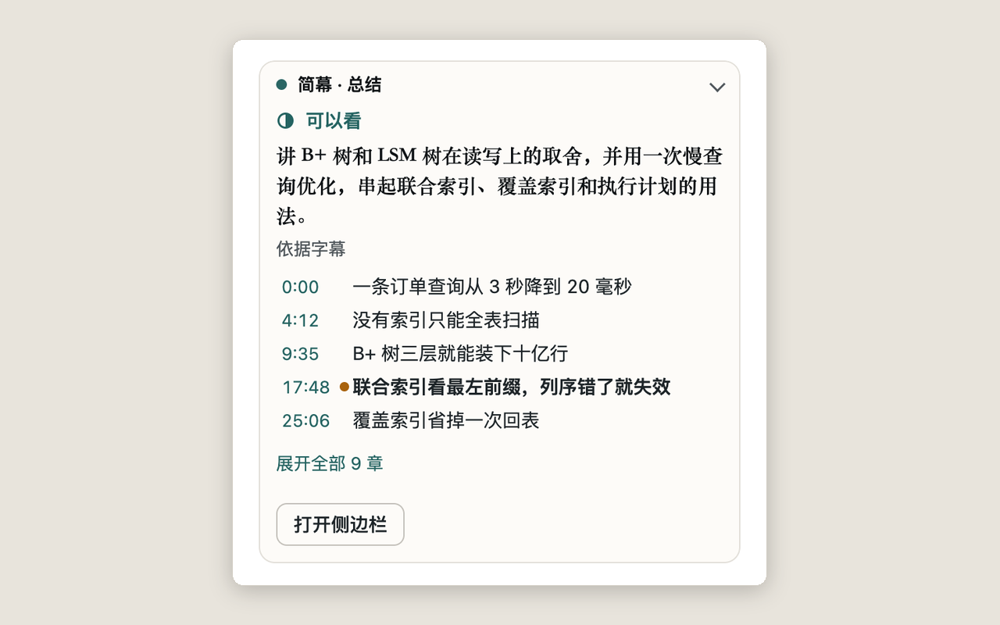
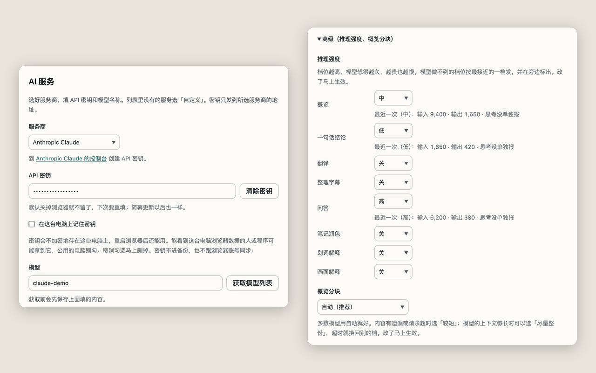

# 简幕

[English](README.en.md)

帮你在几分钟内判断一个 B 站或 YouTube 长视频值不值得看、重点看哪段；决定看了，再陪你精读。

> **当前状态：正在重写，尚未发布，还没有可以下载的安装包。** B 站的主流程（读字幕、生成概览、引用问答、记笔记、播放页卡片和设置页）、稍后再看粗筛、本窗口全部生成、「打开就出结论」和下面列的功能都已经做进主线，自动测试对着本机模拟的页面跑；开发者本人已经在用它日用 B 站。YouTube 的按需授权、读字幕和替你点开文字稿也已经做进主线，开发者本人也在 YouTube 上日用，首发会带上。两站都走通再在 GitHub 发第一个版本（[产品需求说明](notes/product-prd.md)第 1 节）。



简幕是一个 Chrome 扩展（Manifest V3）。没有开发者后端，不要账号；需自备 API 密钥，笔记和概览存在本机，字幕等内容只发给你自己选的模型服务。界面和模型写的内容都可以用中文或英文。

## 目标功能

下面写的是要做到的样子，现在只实现了一部分，实际范围以[产品需求说明](notes/product-prd.md)为准。第一个版本同时支持 B 站和 YouTube。

- **打开就出结论**：打开开关后，B 站上超过设定时长（默认 10 分钟）的视频一打开就生成概览和一句话结论，直接显示在播放页卡片上，不用点。在后台打开的标签页也会排队生成，正在看的先生成，标签页开得越多，花的 API 额度越多。开关新安装默认关，打开前要同意数据说明；开着时会自动把这个视频的字幕、标题和时长、UP 主名和简介发给你选的模型服务。外文视频不自动翻译。
- **速览**：一句话结论带观看判断（推荐看、可以看、可跳过、信息不足），加带时间点的章节，展开章节就能读这一段字幕。
- **精读**：字幕跟着播放走，随时提问、划词解释、记下带时间点的笔记。长视频连续播放满 1 分钟自动切过来。
- **解释当前画面**：点播放器上的图标，把这一帧和前后几句字幕交给能看图的模型，讲清幻灯片、公式、代码或图表在说什么。截图只用这一次，不存。
- **问答**：回答带时间点和引用的字幕原文，点一下跳回视频核对；校验引用，证据不足时如实说明。
- **双语对照**：字幕用你自己的模型翻译，译文和原文并排显示。语言选中文时，中文字幕译成英文，别的语言译成中文；选英文时，英文字幕译成中文，别的语言译成英文。点了就在后台把整个视频译完，关掉侧边栏也继续、会接着用额度，随时可以停。
- **整理字幕**：语音识别的字幕没有标点，点一下用你自己的模型补上标点、改掉明显的同音错字，只改这两样，改写了的那段照旧显示原文。和翻译一样，点了就在后台做完。
- **批量判断**：「本窗口全部生成」把当前窗口开着的 B 站视频一次生成概览，「稍后再看粗筛」把稍后再看列表粗筛一遍。
- **用自己的模型**：想用多强用多强，每个功能可以单独调推理强度；新安装默认省钱。
- **中文或英文**：界面和模型写的内容（概览、结论、回答和解释）都可以用中文或英文，在设置页「外观」一节的「语言」里选，默认跟随浏览器：浏览器界面是中文就用中文，否则用英文。已经生成的内容不跟着换。
- **两个站一个工具**：B 站和 YouTube 用同一个侧边栏看结论、章节和字幕，发布前拿最终的安装包在真实页面上核对。YouTube 要你在侧边栏或设置页点「在 YouTube 上启用」，授权以后才在 YouTube 页面上运行；打开视频后在侧边栏点「读取字幕」，简幕会替你点开页面上的文字稿再读。打开就出结论和本窗口全部生成在 YouTube 上照样能用，读字幕时替你点开文字稿，读完关上。

B 站的字幕和官方总结只给已登录用户读（没登录时只读标题、时长这些视频信息），不下载音视频，不碰确认是付费的内容，规矩见[产品需求说明](notes/product-prd.md)第 8.1 节。YouTube 上简幕不向平台发请求，只读文字稿里已经显示的内容，和播放器上已有的字幕轨列表（用来标出语言和是不是自动生成），不动播放器，规矩见第 8.2 节。

## 界面

截图里的视频、频道和字幕都是为演示自造的，截的是中文界面。







## 安装和更新

现在还没有安装包，下面是首发以后的做法。

需要 Chrome 116 或更新的版本，更早的版本装不上。

实机验证过的 Chrome 版本，首发前补上。<!-- 待定：实机验证过的 Chrome 版本 -->

### 安装

1. 到本仓库的 [Releases](https://github.com/TIAN-TOM/jianmu/releases) 页面，下载最新版的 `jianmu-<版本>.zip`。同名的 `.sha256` 文件可以用来核对下载是否完整。
2. 把 zip 解压到一个固定的文件夹，比如叫 `jianmu`，让 `manifest.json` 直接在这个文件夹里。以后更新还用它，别删也别挪。
3. 在 Chrome 地址栏打开 `chrome://extensions`，打开右上角的「开发者模式」。
4. 点「加载已解压的扩展程序」，选这个文件夹。
5. 点工具栏上的简幕图标打开侧边栏，看完说明点「启用简幕」。图标一开始收在拼图按钮的菜单里，可以固定到工具栏上。右键点这个图标，可以直接打开稍后再看粗筛，或者开关播放页卡片和「打开就出结论」。
6. 打开简幕的设置页，选服务商、填 API 密钥、勾选同意数据说明，再点「保存并授权」，就能用 AI 功能了。

### 更新

简幕不会自己检查新版本。想收到通知，可以在本仓库页面点 Watch，在 Custom 里勾上 Releases。

1. 下载新版的 zip，把解压出来的文件全部复制到原来那个文件夹，覆盖旧文件。
2. 不用再做什么：简幕发现文件换了，会自己重新加载，通常在你下一次用到它的时候。有概览、翻译这类生成在跑，或者正在导出、恢复备份、清除数据时，等它做完再重新加载。重新加载时开着的侧边栏和设置页会关掉，再打开就是新版。想马上换上，也可以打开 `chrome://extensions`，在简幕那一栏点刷新按钮。

笔记、概览、问答和设置都会保留。没选「在这台电脑上记住密钥」的话，更新以后要重新填一次 API 密钥。别先移除扩展再重新加载：移除会删掉简幕存在这台电脑上的资料。

## 隐私

没有开发者服务器。笔记、概览、问答、设置和缓存都存在这台电脑的浏览器里。字幕、标题和简介、你的问题、点「解释当前画面」时的那一帧画面这类内容，要你先同意数据说明，才会发给你自己选的模型服务：平时在你用 AI 功能时发，打开「打开就出结论」以后也会自动发。详细见[隐私政策](PRIVACY.md)。

## 关键设计取舍

下面是已经定下的设计，代码还在移植。

- **不设后端。** 开发者收不到用户的内容，也就没有账号、统计和服务器成本；代价是用户要自备密钥，费用自担。
- **站点差异收在适配层。** 概览、问答、任务和存储两站共用；站点专属的能力是契约里的可选方法，没有就不显示，不造假数据。
- **视频身份只有一种写法。** 所有键都由 `{platform, videoId, segment?}` 生成；字幕和官方总结带内容指纹，每份结果都记下依据的是哪一版。
- **启用、授权、同意分开管。** 在本机读取要先确认，访问网站靠浏览器授权，发给模型要另外同意，哪一项都不代替另外两项。
- **花钱的入口有来源和限额。** 网页发来的信号不能直接触发付费请求；取消和后台中断以后不自动重发。
- **工具链从简。** TypeScript 加一个自写的 esbuild 构建脚本，单元测试用 Node 直接跑 `.ts`，核心逻辑不依赖浏览器。

代码怎么组织、为什么这样选，见[架构设计](notes/architecture.md)。

## 文档

- [产品需求说明](notes/product-prd.md)：做什么、为谁做、分几版发、每一步做到哪里算完。
- [架构设计](notes/architecture.md)：代码结构、数据、测试和实施顺序。

## 开发

要求 Node 24.12 以上、npm 11.10 以上。

```bash
npm ci
npm run check
```

开发约定见 [AGENTS.md](AGENTS.md)，安全问题的报告方式见 [SECURITY.md](SECURITY.md)。

## 许可和致谢

MIT 许可，见 [LICENSE](LICENSE)。

YouTube 是 Google LLC 的商标。哔哩哔哩和 bilibili 是其权利人的商标。简幕是个人开发的独立工具，与 Google、YouTube 和哔哩哔哩没有关联，也没有获得它们的授权或认可。

最早基于 [Digest for Bilibili](https://github.com/biuworks/bilibili-digest) 分叉，正在重写。
